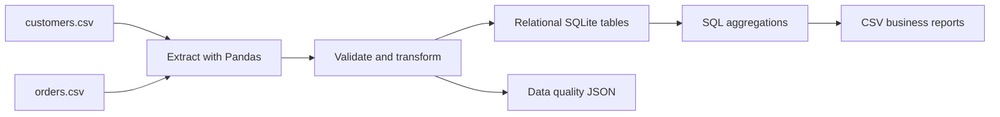

# Customer Orders ETL Pipeline

**Python · Pandas · SQL · SQLite · ETL · Data Quality**

A reproducible end-to-end ETL project that extracts customer and order data from CSV files, validates and transforms records with Pandas, loads relational tables into SQLite, and creates SQL-driven business reports.

> **Dataset notice:** The bundled customer and order records are synthetic sample data created for this portfolio project. They do not represent real people, customers, companies or transactions. The input deliberately includes duplicate, malformed and invalid records so that data-quality handling can be demonstrated.

## Business questions

- How does revenue change month to month?
- Which regions and customer segments contribute the most revenue?
- Which products generate the most net revenue?
- Which customers have the highest lifetime revenue?
- How many source rows were invalid, duplicated or linked to unknown customers?

## Pipeline architecture



## Technology stack

- Python 3.10+
- Pandas for extraction, validation and transformation
- SQLite for relational storage, constraints, indexes and views
- SQL for aggregations and business reporting
- `unittest` for automated checks
- GitHub Actions for repository CI

## Run locally

From the project directory:

```bash
python -m venv .venv
```

Activate the environment:

```powershell
# Windows PowerShell
.venv\Scripts\Activate.ps1
```

```bash
# macOS / Linux
source .venv/bin/activate
```

Install and run:

```bash
python -m pip install -r requirements.txt
python -m src.etl_pipeline
```

Run the test suite:

```bash
python -m unittest discover -s tests -v
```

## ETL stages

### 1. Extract
Read `data/customers.csv` and `data/orders.csv` with Pandas.

### 2. Transform and validate
Customer processing trims whitespace, rejects blank customer IDs/names and retains one customer record per ID. Order processing parses dates and numeric fields, checks required identifiers, positive quantities, non-negative prices and discounts between 0 and 100, removes repeated order IDs, and rejects orders referring to customers absent from the cleaned customer table.

Net revenue is calculated as:

```text
quantity × unit_price × (1 − discount_pct / 100)
```

### 3. Load
Load customers and orders into SQLite with primary keys, a foreign key, check constraints, useful indexes and an `order_enriched` view. A run rebuilds the sample warehouse from the input CSVs, making repeated runs deterministic and avoiding duplicate accumulation.

### 4. Report
SQL queries generate monthly revenue, region revenue, segment revenue, product revenue and top-customer reports. The run also writes a JSON data-quality summary.

## Sample data quality outcome

For the bundled files, the expected run is:

| Check | Count |
|---|---:|
| Customer rows read | 14 |
| Invalid customer rows | 1 |
| Duplicate customer rows | 1 |
| Customers loaded | 12 |
| Order rows read | 36 |
| Invalid order rows | 4 |
| Duplicate order rows | 1 |
| Orders with unknown customers | 1 |
| Orders loaded | 30 |

These counts describe the included synthetic sample only.

## Output files

Generated under `reports/`:

- `customer_orders.db` — SQLite database
- `monthly_revenue.csv`
- `region_revenue.csv`
- `segment_revenue.csv`
- `product_revenue.csv`
- `top_customers.csv`
- `data_quality.json`

Generated database and report files are ignored by Git; they can be recreated by running the pipeline.

## SQL exploration

Open the generated database with any SQLite client, then run statements from `sql/analysis_queries.sql`. The schema and relational view are defined in `sql/schema.sql`.

## Repository structure

```text
customer-orders-etl/
├── data/
│   ├── customers.csv
│   └── orders.csv
├── reports/
│   └── .gitkeep
├── sql/
│   ├── analysis_queries.sql
│   └── schema.sql
├── src/
│   ├── __init__.py
│   └── etl_pipeline.py
├── tests/
│   ├── __init__.py
│   └── test_etl_pipeline.py
├── .gitignore
├── README.md
└── requirements.txt
```

## Future improvements

- Add incremental loading and watermarks for larger input batches.
- Add structured logging, retries and schema-version management.
- Add a dashboard on top of the generated warehouse tables.
- Add data contracts and more edge-case tests.

## Scope and accuracy

This is a newly created portfolio learning project, separate from my earlier academic projects. The code and synthetic input data are included to make the ETL flow reproducible. No production data source, orchestration platform or live business system is connected.
