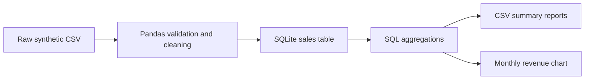

# Retail Sales Analytics Pipeline

**Python · Pandas · SQL · SQLite · Matplotlib**

A reproducible portfolio project that turns raw retail transaction data into a cleaned SQLite dataset, SQL-based business summaries and a monthly revenue chart.

> **Dataset notice:** `data/sales.csv` is entirely synthetic sample data generated for this learning project. It contains no real customer, company or transaction information. The sample intentionally includes a duplicate transaction and an invalid row so the cleaning step can be demonstrated.

## Business questions

- How does net revenue change month to month?
- Which product categories generate the most revenue?
- Which products contribute the most net revenue?
- How does revenue vary by region?
- What are total orders, total net revenue and average revenue per order?

## Pipeline



## Tech stack

- **Python 3.10+** for the pipeline
- **Pandas** for loading, validation, cleaning and report generation
- **SQLite** for structured storage and SQL analytics
- **Matplotlib** for a simple revenue visualization
- **unittest** for basic data-pipeline tests

## Run locally

1. Clone the profile repository and enter the project folder:

   ```bash
   git clone https://github.com/rasheem897/rasheem897.git
   cd rasheem897/projects/retail-sales-analytics
   ```

2. Create and activate a virtual environment (Windows PowerShell):

   ```powershell
   py -m venv .venv
   .venv\Scripts\Activate.ps1
   ```

   macOS/Linux:

   ```bash
   python3 -m venv .venv
   source .venv/bin/activate
   ```

3. Install dependencies and run:

   ```bash
   python -m pip install -r requirements.txt
   python src/run_analysis.py
   ```

4. Run tests:

   ```bash
   python -m unittest discover -s tests -v
   ```

## Data quality steps

The pipeline:

- checks that required columns are present;
- parses order dates and numeric fields;
- removes rows with missing or invalid order IDs, dates, quantities or prices;
- removes duplicate order IDs, keeping the first occurrence;
- replaces missing customer, region, category or product labels with `Unknown`;
- defaults missing discounts to zero and excludes discounts outside 0–100%;
- calculates `net_revenue = quantity × unit_price × (1 − discount_pct / 100)`.

## Sample run

The bundled 50-row synthetic input contains one invalid row and one duplicate order. A successful run currently reports:

| Metric | Result |
|---|---:|
| Rows loaded | 50 |
| Invalid rows removed | 1 |
| Duplicate rows removed | 1 |
| Clean transactions | 48 |
| Total orders | 48 |
| Total net revenue | 139,903.00 |
| Average revenue per order | 2,914.65 |

These values are outputs from the bundled synthetic data, not real business performance.

## Outputs

The script creates these files under `reports/`:

- `sales_analytics.db` — SQLite database containing the cleaned `sales` table;
- `monthly_revenue.csv` — monthly revenue and order counts;
- `category_revenue.csv` — revenue and units sold by category;
- `top_products.csv` — five highest-revenue products;
- `region_revenue.csv` — revenue and order counts by region;
- `monthly_revenue.png` — monthly revenue chart.

Generated outputs are ignored by Git so the repository remains focused on source files and reproducible input data.

## SQL exploration

`sql/schema.sql` defines the SQLite table and indexes. `sql/analysis_queries.sql` contains the business-analysis queries. After running the pipeline, inspect the database with:

```bash
sqlite3 reports/sales_analytics.db
```

Then run a query from `sql/analysis_queries.sql`.

## Project structure

```text
retail-sales-analytics/
├── data/
│   └── sales.csv
├── reports/
│   └── .gitkeep
├── sql/
│   ├── analysis_queries.sql
│   └── schema.sql
├── src/
│   └── run_analysis.py
├── tests/
│   └── test_pipeline.py
├── .github/
│   └── workflows/
│       └── python-check.yml
├── .gitignore
├── README.md
└── requirements.txt
```

## Possible extensions

- Add a Power BI dashboard using the exported CSV summaries or SQLite database.
- Add month-over-month growth, discount analysis and repeat-customer metrics.
- Add a scheduled ingestion workflow and more edge-case tests.

## Scope and accuracy

This is a newly created portfolio learning project, separate from my academic projects. The data is synthetic and the reported figures are generated from it. The implementation is provided so the analysis can be run and reviewed directly.
